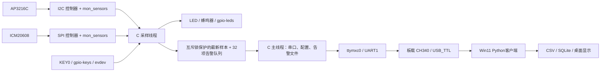

# 代码设计方案

## 整体结构

第一版为两个 C 线程。采样线程负责阻塞的传感器访问，主线程负责 poll、串口和磁盘。这种规模下磁盘读写直接在主线程串行执行，减少复杂度；它可能延迟控制命令和遥测发送，但不会持锁阻塞整个采样流程。没有声称硬实时，未引入线程池/epoll/无锁队列。

## 文件与职责

| 文件 | 职责 | 要读懂的接口 |
|---|---|---|
| common/protocol.c | 帧编码、CRC、字节状态机与重新同步 | mon_encode / mon_feed |
| board/src/main.c | 参数、线程、队列、告警状态、命令分发、补传 | pthread_create / mutex / poll |
| board/src/serial.c | 115200 8N1、raw 模式、非阻塞 IO、写超时 | termios / write / poll |
| board/src/config.c | 严格解析三个无符号整数，防溢出与部分更新 | strtoul / errno |
| board/src/storage.c | 配置与事件落盘、确认删除、容量限制 | fsync / rename / unlink |
| board/src/sensors.c | 读取驱动 ABI、字节序转换、运动指标、输入事件与输出 | read / evdev / sysfs |
| drivers/mon_sensors.c | I2C/SPI 探测与初始化、misc设备、错误检查 | probe / misc_register / copy_to_user |
| host/client.py | 收发、请求应答、CSV、事件提交与确认 | 接收线程 / Event / Lock / SQLite |
| host/dashboard.py | Tk显示与操作，主线程更新控件 | after / Queue |
| host/upload.py | 已登录 shell 上的串口文件传输 | base64 / SHA256 / 逐块接收确认 |

## 数据格式与单位

AP 驱动每次 read 返回 6 字节：寄存器 0x0A～0x0F 原始值，光照 ALS 是第 2、3 字节的小端无符号值。IR/PS 目前不用于判定；不能把 PS 直接解释为厘米。

ICM 驱动返回 14 字节：0x3B 开始的加速度 XYZ、温度、角速度 XYZ，大端有符号 16 位。用户态负责转换。本项目量程设置为 ±2g、±250°/s，和教程示例的 ±16g、±2000°/s 不同，因此不可复用其换算常数。当前 PC 展示 raw；需要物理单位时分别按 16384 LSB/g 与 131 LSB/(°/s) 转换并做零偏校准。

运动指标是相邻两次采样三轴差值绝对值的最大值。它会受到采样周期、姿态变化、重力投影和量程影响。5Hz 上报/采样适合演示慢速晃动，不适合冲击捕获或振动诊断。改成高采样率时应使用 FIFO/中断/IIO buffer，并重新规划串口带宽。

## 并发与所有权

- `shared.mu` 保护配置、最新样本、告警队列及计数器。锁内只复制/更新少量内存，不做 I2C/SPI/串口/磁盘 IO。
- 采样线程独占传感器和 LED/蜂鸣器/按键 FD；主线程独占串口 FD、磁盘日志和协议解析器。
- 实时数据只有一个“最新值”槽；主线程忙时会跳过中间样本，这是有意的背压策略。
- 告警队列 32 项；满时丢弃新告警，`dropped` 递增。磁盘最多 128 个待确认事件；满/写失败增加 `storage_errors`。
- 主线程一次 UART 写操作最多等待 300ms；没有配置 RTS/CTS，不能声称对端断开时 UART write 必然报错。PC 通过 STATUS 心跳让板端判断是否继续发遥测。
- SIGINT/SIGTERM 只设置 `sig_atomic_t` 标志；退出时 join 线程、关闭蜂鸣器、恢复 termios。

## 告警状态机

任一阈值越界进入 active，并仅在 inactive→active 边沿生成一条告警。持续越界不会每周期刷告警。PC SILENCE 或 KEY0 使当前 active 周期消音；条件恢复正常后清除消音标志，下次越界重新报警。按键与 PC 消音不等于事件送达确认，不能删除未送达的告警。

当前未加阈值回差/连续 N 次确认，阈值附近来回变化可能重复触发；可以作为下一轮算法改进。传感器读取失败时 `valid=0`，不产生伪造新事件；保留之前报警状态并计数，PC可辨认无效样本。

## 持久化与送达语义

配置先写 `.pending`，fsync 文件，rename，再 fsync 所在目录，成功后更新内存配置并回 ACK。磁盘故障时不宣称保存成功；若 rename 后目录 fsync 失败，磁盘最终状态可能不确定，操作端需查询/重试。

事件 ID 为启动随机 64 位 + 本次启动 32 位计数，持久文件保存完整 ID。PC 以 ID 作 SQLite 主键，事务提交后发 EVENT_ACK；重传同一 ID 不重复入库。ACK 丢失时会再次收到同一事件并再次确认。这是“至少一次尝试传输 + 接收端去重”，不是无条件 exactly-once。

采样到进入磁盘之间的 RAM 队列在断电时会丢失；磁盘上已完成持久化的待确认事件可在重启后补传。用户手动删除/格式化数据、磁盘损坏、满队列以及校验无法保证的介质掉电行为都不在“绝不丢数据”保证内。默认 `/var/lib` 若是 tmpfs，重启后不保留，部署时必须核实挂载。

PC CSV每条flush，但不是每条fsync，断电可能丢失尾部曲线；告警SQLite使用FULL同步并提交后确认。日志总容量未自动删除，用户需要归档。板端 session.log 也需要轮转。

## 驱动设计

目标 API 是随板资料的 Linux 4.1.15。两个总线驱动装在一个模块，采用不同 `compatible` 避免与原例程抢设备。`probe` 校验总线操作与芯片状态，所有传输错误向用户态返回负 errno；成功 read 返回实际字节数。不能把教程某些版本“拷贝成功却返回0”的行为带入本项目。

用 mutex 保护睡眠型总线访问，不在硬中断里做 I2C/SPI 读。本模块不额外申请按键中断，KEY0 由标准 gpio-keys 驱动处理，应用从 evdev 读取。LED/蜂鸣器由 gpio-leds 处理，避免同一GPIO被两个驱动重复申请。

模块每种芯片仅支持一个实例，用静态对象及锁保护 unbind：删除设备后已有文件描述符读取返回 ENODEV；模块 owner 阻止有打开文件时正常卸载。该实现是针对一块固定板卡的教学实现，多设备框架与 IIO 改造是可继续深入的方向。

## 控制台和业务串口

开发阶段从现有串口 shell 启动 `run-session.sh`，shell等子进程结束、不再读输入，降低printk等级，把应用日志写文件；这是临时切换，仍可能被紧急内核日志污染。解析器能跳过多数无关字符/CRC错误，但不能消除并发写入造成的丢帧。

长期部署应从 bootargs 去掉 UART1 console（同时核对 DT chosen/stdout-path、earlycon/earlyprintk），停用该口 getty，并独立启动业务进程；必须留有 U-Boot 恢复/其他调试通路。项目不自动改这些启动设置。
